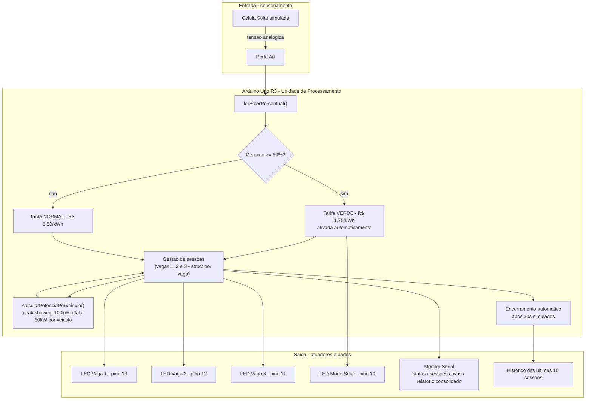

[README_Sprint4.md](https://github.com/user-attachments/files/33732391/README_Sprint4.md)
# ⚡ Estação LightWeek

### Sprint 4 — Solução Final Integrada e Inovadora (Desafio FIAP + GoodWe)

---

## 📋 Equipe e RMs

* **Maykon de Lima Silva** — RM: 574022
* **Felipe Pereira Restivo** — RM: 570712
* **Gabriel Rodrigues Zappelloni** — RM: 572060
* **Rodger Costa Rios** — RM: 571438
* **Kenichi Caio Yamamoto** — RM: 569815

**Turma:** 1CCPK
**Disciplina:** SERS — André Tritiack
**Contexto:** Sprint 4 — consolidação final do desafio GoodWe, integrando o trabalho das três sprints anteriores em uma única solução coerente, documentada e demonstrável.

---

## 1. 🚀 Visão Geral da Solução

A **Estação LightWeek** é um protótipo simulado de estação inteligente de recarga de veículos elétricos (EVs) que integra **geração solar**, **gestão automatizada de sessões de recarga** e **tarifação dinâmica** para endereçar o desafio proposto pela GoodWe: como tornar o consumo de energia em pontos de recarga mais eficiente, sustentável e alinhado à disponibilidade de energia renovável.

A solução final é o resultado da evolução contínua ao longo de três sprints:

| Sprint | Entrega | O que resolveu |
|---|---|---|
| 1 | **ChargeGrid Intelligence** | Definiu o problema, os 4 pilares de eficiência energética do projeto e validou a viabilidade regulatória junto à ANEEL (Resolução Normativa nº 1.000/2021) |
| 2 | **Estação LightWeek (PoC)** | Primeira prova de conceito em hardware/IoT simulado (Tinkercad): leitura de geração solar, LEDs por vaga, peak shaving e desconto na tarifa verde |
| 3 | **Sessões estruturadas e automação** | Evoluiu a PoC para sessões de recarga completas (início/fim, duração, energia, valor cobrado), decisões automáticas de tarifa e um painel de dados via Monitor Serial |
| **4** | **Este documento** | Integra as três entregas em uma solução única, documentada de ponta a ponta, com avaliação crítica de sustentabilidade e inovação |

Nenhum componente de hardware físico foi usado — toda a integração sensor → processamento → atuador → dado é simulada e validada no **Tinkercad**, o que garante reprodutibilidade total para a banca avaliadora sem custo de montagem.

---

## 2. 🏛️ Arquitetura Final Integrada



**Como ler o diagrama:** a célula solar é a única entrada física do sistema. A partir dela, toda a cadeia de decisão — tarifa, alocação de potência entre vagas, acionamento dos LEDs e geração dos relatórios — acontece de forma automática, sem depender de nenhuma interface externa além do Monitor Serial do próprio Arduino. Essa simplicidade de integração (um sensor, uma unidade de processamento, atuadores físicos e um canal de dados) é o que torna a solução replicável em um microcontrolador real (ex. ESP32 com Wi-Fi) em uma etapa futura.

---

## 3. 💡 Diferenciais Inovadores da Solução

| Diferencial | Como funciona | Por que é inovador |
|---|---|---|
| **Tarifação dinâmica automática** | O sistema lê continuamente a geração solar e alterna sozinho entre tarifa normal e verde, sem intervenção humana | Em vez de uma tarifa fixa, o preço cobrado reflete em tempo real a disponibilidade de energia limpa — um incentivo econômico direto ao uso sustentável |
| **Peak shaving dinâmico** | A potência disponível por veículo é recalculada automaticamente a cada entrada/saída (100 kW total / até 50 kW por vaga) | Protege a rede elétrica simulada contra sobrecarga sem exigir supervisão manual, um dos 4 pilares definidos na Sprint 1 |
| **Sessões estruturadas com histórico (dado funcional)** | Cada vaga carrega seu próprio registro (início, potência, tarifa aplicada), permitindo calcular energia (kWh) e valor cobrado por sessão | Transforma um protótipo reativo em um sistema que produz dado de operação real, auditável e agregável |
| **Encerramento automático por tempo** | Sessões são fechadas sozinhas após o tempo simulado, calculando e registrando o resultado sem ação do usuário | Demonstra automação de ponta a ponta, equivalente a um carregador real que encerra ao detectar bateria cheia |
| **Painel de dados via Monitor Serial** | Comandos (`l`, `r`, `s`) entregam, em texto, visão de sessões ativas e relatório consolidado (energia total, receita, economia gerada pela tarifa verde) | Cumpre o papel de um dashboard de visualização de dados sem exigir uma camada web adicional, mantendo o protótipo 100% reproduzível dentro do Tinkercad |

> Esses diferenciais já estavam presentes, em grau crescente, desde a Sprint 2/3; o que a Sprint 4 agrega é a **leitura integrada** deles como uma solução única e a análise crítica de impacto que seguem nas próximas seções.

---

## 4. 🎯 Justificativa de Alinhamento ao Desafio GoodWe e à Disciplina

* **Sustentabilidade e eficiência energética:** a tarifa dinâmica atrelada à geração solar traduz em código o conceito de gestão de demanda alinhada à disponibilidade de energia limpa, incentivando o consumo nos horários de maior produção fotovoltaica e reduzindo a dependência de fontes não renováveis nos horários de pico — objetivo central de qualquer solução no ecossistema GoodWe (geração solar + armazenamento + gestão inteligente).
* **Automação inteligente:** as decisões de tarifa, alocação de potência e encerramento de sessão acontecem sem intervenção humana — a essência de um sistema de automação, em oposição a um circuito puramente reativo a comandos manuais.
* **IoT (sensoriamento + atuação):** o ciclo sensor (célula solar) → processamento (Arduino) → atuador (LEDs) → dado (Monitor Serial) é o modelo básico de um sistema IoT, aqui aplicado à gestão de infraestrutura de recarga — o mesmo paradigma usado por inversores e sistemas de monitoramento GoodWe no mundo real.
* **Integração de sistemas:** a evolução de um contador simples (Sprint 2) para sessões estruturadas com histórico (Sprint 3) é uma aplicação prática de modelagem de dados (structs) para representar entidades do mundo real — uma sessão de recarga — dentro de um sistema embarcado.
* **Viabilidade regulatória (ANEEL):** a lógica de tarifação dinâmica simulada é a materialização, em código, do pilar de "Tarifação Dinâmica" e da Resolução Normativa ANEEL nº 1.000/2021, discutidos e validados já na Sprint 1.

---

## 5. 📊 Resultados Quantitativos e Qualitativos

O protótipo produz, por sessão de recarga encerrada:

* Vaga, duração (s), energia estimada (kWh), tarifa aplicada (normal/verde) e valor cobrado (R$)
* Quando a tarifa é verde, também a economia gerada em relação à tarifa normal

E, de forma agregada (comando `r`):

* Total de sessões concluídas e quantas delas em tarifa verde
* Energia total entregue (kWh)
* Receita total (R$) e economia total gerada pela tarifa verde (R$)
* Histórico das últimas 10 sessões

> ⚠️ **A preencher pelo grupo antes da entrega:** o bloco abaixo é apenas um exemplo ilustrativo do formato de saída. Rodem a simulação final no Tinkercad, testem os comandos `1`, `2`, `l`, `s` e `r`, e substituam pelo print ou transcrição real do Monitor Serial de vocês — a banca avalia dado real, não ilustrativo.

```
----- STATUS DA ESTACAO -----
Geracao solar atual : 62.3 %
Tarifa em vigor      : VERDE (desconto solar)
Vagas ocupadas       : 2 de 3
Potencia por veiculo : 50.00 kW

<< Sessao encerrada na vaga 1
   Duracao: 18 s
   Energia estimada: 0.2500 kWh
   Valor cobrado: R$ 0.44
   Economia (tarifa verde): R$ 0.19

========= RELATORIO CONSOLIDADO =========
Sessoes concluidas total : 3
  - com tarifa verde     : 2
Energia total entregue   : 0.9800 kWh
Receita total            : R$ 1.87
Economia gerada (verde)  : R$ 0.51
```

**Leitura qualitativa:** mesmo em escala simulada, os números comprovam o mecanismo central da proposta — toda vez que a geração solar cruza o limiar de 50%, a tarifa cai automaticamente e a economia é contabilizada e exibida sem qualquer ação manual, validando o pilar de tarifação dinâmica definido desde a Sprint 1.

---

## 6. ⚖️ Avaliação Crítica — Sustentabilidade e Inovação

**Pontos fortes:**
- A automação de ponta a ponta (leitura → decisão → atuação → dado) elimina a dependência de operação manual, o que é essencial para uma solução escalável de verdade.
- A tarifação dinâmica cria um incentivo econômico direto e imediato ao uso de energia limpa, em vez de depender apenas de conscientização.
- Toda a solução é reproduzível gratuitamente no Tinkercad, o que reduz a barreira de entrada para validação e extensão por terceiros.

**Limitações reconhecidas (honestidade acadêmica):**
- A simulação usa um Arduino Uno R3 sem conectividade — uma implementação real precisaria migrar para um microcontrolador com Wi-Fi/BLE (ex. ESP32), já previsto como próximo passo na Sprint 3.
- Os dados de geração solar e os tempos de sessão (30s) são simulados/acelerados para fins de demonstração; em um cenário real, a curva de geração solar e a duração das sessões seriam medidas em escalas de minutos/horas.
- O "painel de dados" ainda é textual (Monitor Serial); uma versão de produção se beneficiaria de uma interface gráfica ou dashboard web, apontado como evolução natural, não como entrega desta sprint.

**Impacto potencial se escalado:** ao aplicar o mesmo princípio de tarifação dinâmica e peak shaving a uma frota real de estações de recarga integradas a inversores GoodWe, o sistema poderia deslocar uma parcela relevante do consumo de recarga para os horários de maior geração solar, reduzindo picos de demanda na rede e aumentando o autoconsumo de energia renovável gerada localmente.

---

## 7. 🔗 Referências, Ferramentas e Conexões

| Categoria | Item | Papel na solução |
|---|---|---|
| Hardware simulado | Arduino Uno R3 | Unidade de processamento central |
| Simulação | Tinkercad | Ambiente de prototipagem e validação sem custo de componentes físicos |
| Linguagem | C/C++ (Arduino Sketch) | Lógica de leitura do sensor, tarifação, peak shaving e sessões |
| Sensor | Célula solar (entrada analógica, porta A0) | Representa a geração fotovoltaica variável ao longo do dia |
| Atuadores | LEDs (pinos 10, 11, 12, 13) | Evidência física de automação (vaga ocupada / modo solar ativo) |
| Interface de dados | Monitor Serial do Arduino IDE/Tinkercad | Canal de comandos (`1`,`2`,`3`,`+`,`-`,`s`,`l`,`r`,`h`) e exibição de relatórios |
| Regulação | ANEEL — Resolução Normativa nº 1.000/2021 | Base regulatória da tarifação dinâmica, validada na Sprint 1 |
| Ecossistema do desafio | GoodWe (inversores solares e gestão de energia) | Referência de mercado para o conceito de geração + armazenamento + consumo inteligente que a solução simula em escala reduzida |

---

## 8. 💻 Instruções de Reprodução

### Montagem do circuito (Tinkercad)

| Componente | Pino do Arduino |
|---|---|
| LED Vaga 1 (+ resistor) | Digital 13 |
| LED Vaga 2 (+ resistor) | Digital 12 |
| LED Vaga 3 (+ resistor) | Digital 11 |
| LED Modo Solar (+ resistor) | Digital 10 |
| Célula Solar (saída +) | A0 |
| Célula Solar (GND) | GND |

### Comandos disponíveis

| Comando | Ação |
|---|---|
| `1` / `2` / `3` | Liga ou desliga a sessão de recarga na vaga correspondente |
| `+` | Inicia sessão na primeira vaga livre |
| `-` | Encerra a sessão ativa mais antiga |
| `s` | Mostra o status atual (solar, tarifa, potência) |
| `l` | Lista as sessões ativas no momento |
| `r` | Gera o relatório consolidado (dados funcionais) |
| `h` | Mostra o menu de ajuda |

### Simulação pronta (Wokwi)

O circuito acima já está montado e testado no Wokwi, com o código deste repositório carregado:

🔗 **https://wokwi.com/projects/478425380337918977**

Basta abrir o link, clicar em ▶ (play) para iniciar a simulação e usar o Monitor Serial (campo de texto na parte inferior do painel) para digitar os comandos.

---

## 9. 🎥 Vídeo Demonstrativo (Sprint 4)

https://youtu.be/Vk162ftpYhU

---

## 10. 🔗 Repositório

https://github.com/zappelloni/sprint4-SERS
